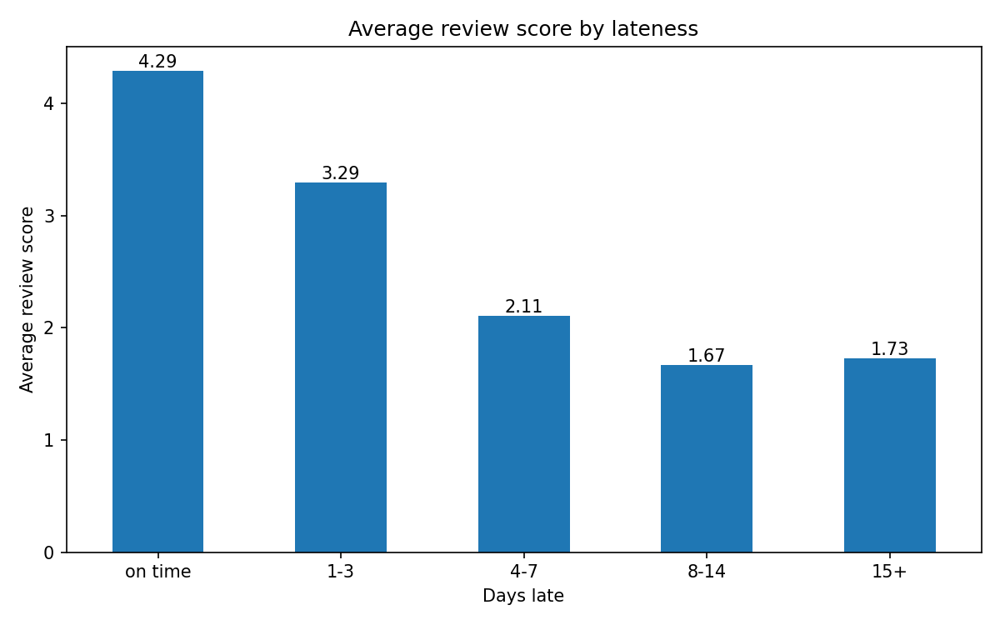
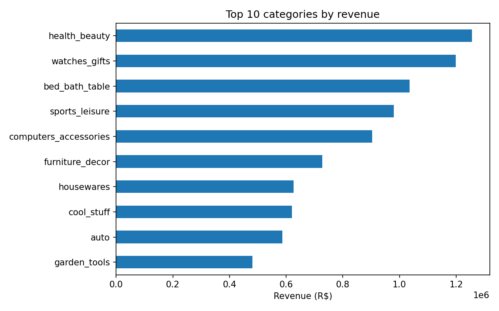

# Olist E-Commerce Analysis

One or two sentences: what this project is and why it matters.

## Business questions
1. How many orders fail, and how much revenue does that affect?
2. Do late deliveries get lower review scores?
3. Which product categories drive revenue?

## Key findings
- Q1: 1,234 of 99,441 orders (1.2%) were canceled or unavailable. Their items account for about R$97K of R$13.6M in item revenue (0.72%). This   is a lower bound, because most unavailable orders have no items in the data. 
- Q2: Yes, late deliveries get lower review scores
- Q3: health_beauty, watches_gifts and bed_bath_table lead on revenue. watches_gifts earns revenue from fewer, pricier items (~R$201 each), and 5 of its 101 sellers hold about 63% of its revenue.

## Data
Olist Brazilian E-Commerce dataset on Kaggle (link). The data isn't included in this repo because of its size. Download it into a `data/` folder.

## How to run
1. Clone the repo
2. pip install pandas matplotlib seaborn jupyter
3. Put the CSVs in `data/`
4. Open notebooks/olist_analysis.ipynb

## Limitations
- Correlation, not causation
- Revenue lost is a lower bound
- (add one more of your own)

## Tools
Python, pandas, matplotlib, Jupyter